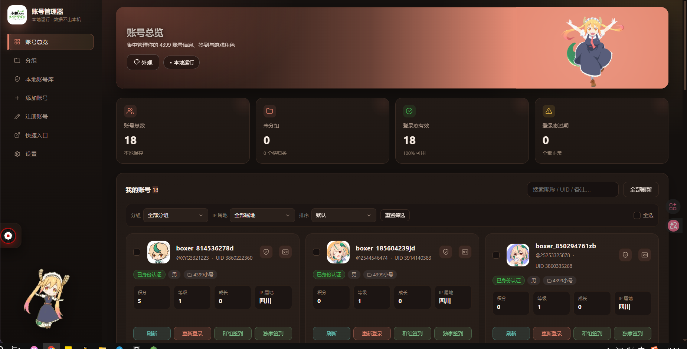
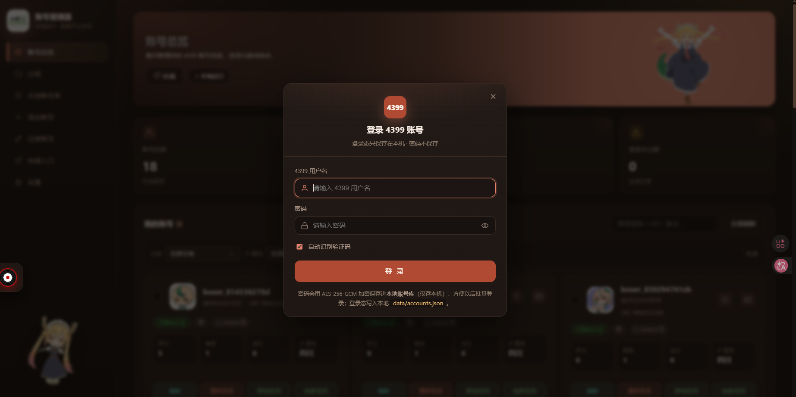

<div align="center">

# 4399 账号管理器

**本地运行 · 数据不出本机 · 零第三方依赖**


</div>

## 项目介绍

一个**本地运行**的第三方 4399 账号管理工具：网页前端 + Node.js 后端，**零第三方依赖**（没有 `package.json`，不需要 `npm install`，也不需要构建）。

只用于管理**你自己的** 4399 账号。登录态与账号数据全部保存在本机 `data/` 目录，服务只监听 `127.0.0.1`，同一局域网内其它设备也访问不到。

核心能力：

- **多账号集中管理**：登录态、昵称、UID、头像、积分、等级、成长值、性别、地区、IP 属地、认证状态一屏看完
- **一键签到**：群组首页签到 + 独家游戏签到，支持批量
- **本地账号库**：账号密码以 **AES-256-GCM 加密**落盘，支持批量登录，不用一个个手输
- **区服角色查询**：按游戏缩写查询各区服下的角色，内置常用游戏预设
- **资料修改 / 换头像**：昵称、性别、生日、地区，以及本地上传头像
- **三套深色主题**：4399 石墨橙、小林家的龙女仆、梵高「星空」一键切换
- **较长的任务可取消**：区服查询、实名查询走任务队列，随时中断，中间结果保留

## 项目图片

### 账号总览



### 登录 4399 账号



## 项目实现方式

整个项目是**手写**的，没有用任何框架、脚手架或 npm 包，只依赖 Node.js 内置模块。

| 层 | 实现方式 |
|---|---|
| **后端** | Node.js 原生 `http` / `fs` / `path` / `child_process` / `crypto`，单文件 `server.js` + `lib/`，无构建步骤 |
| **前端** | 原生 HTML + CSS + ES2020 JavaScript，无框架、无打包器，静态文件直接由后端服务 |
| **登录协议** | 走 4399 网页 OAuth（`ptlogin.4399.com/oauth2/authorize.do` → `loginAndAuthorize.do`），手写 CookieJar 维护会话 |
| **网络层** | 自实现极简 HTTP 客户端（重定向跟随、multipart 上传、指数退避重试）；登录类请求不重试，避免重复提交 |
| **数据存储** | 本地 JSON 文件（`data/`）。账号登录态明文保存，账号密码用 **AES-256-GCM** 加密，单密钥 + 每行随机 IV |
| **长任务** | 服务端 Job 表 + 前端约 320ms 轮询，提供 `/api/jobs/:id` 与 `/cancel`，取消后仍返回已完成的中间结果 |
| **并发与限流** | 区服查询采用「波浪并发」：初始并发 3，一旦命中 4399 限流自动降到 1 并退避；批量刷新整波失败则转串行 |
| **风控识别** | 识别 4399 限流 / 静默风控特征，命中后自动停机并 30 秒 × 2 次退避，不做绕过 |
| **验证码** | 64 位 Node 无法加载 32 位 OCR 模型，因此用 `tools/ocrbridge.exe` 做子进程桥（源码 `tools/OcrBridge.cs`）；识别失败自动退回手动输入 |
| **主题系统** | 纯 CSS 自定义属性 + `html.theme-*` 类切换，三套配色互不干扰，无 JS 重绘 |
| **图标** | 内联 SVG 路径表（`ICONS` map），不用图标字体、不用 Emoji |
| **宣传片** | Canvas 2D 逐帧绘制动画，`MediaRecorder` 录制 1920×1080 视频并回传本地保存（`public/promo-studio.html`） |

## 功能明细

<details>
<summary>展开完整功能列表</summary>

### 账号

- **登录**：网页 OAuth，需要时弹图形验证码；已配置 OCR 时优先自动识别
- **账号信息**：昵称、UID、头像、积分、等级、成长值、性别、生日、地区、IP 属地、认证状态
- **签到**：群组首页签到（`my.4399.com`）+ 独家游戏签到（`huodong.4399.com`）
- **批量操作**：批量刷新（波浪并发）、批量签到、批量登录
- **分组与备注**：账号可归入分组、添加备注；支持按分组 / IP 属地筛选与排序
- **游玩历史**：最近玩过的游戏（图标 / 分类 / 星级）
- **编辑资料**：昵称 / 性别 / 生日 / 地区（省 · 市）
- **更换头像**：本地选图上传
- **实名查询**：状态优先流程，可自动解除占用，结果本地缓存 24 小时

### 本地账号库

- 「账号 + 密码」单独保存，**密码以 AES-256-GCM 加密落盘**（`data/vault.json`），密钥为 `data/vault.key` 随机 32 字节
- 支持文本批量导入、文件夹批量导入、单条编辑 / 删除
- 用于批量登录，避免一个个手输

### 界面

- **三套深色主题**：4399（石墨底 + 品牌橙）、小林家的龙女仆（托尔）、梵高「星空」
- 音乐组件：网易云官方外链播放器，贴边唱片样式，悬浮自动展开，**默认暂停**
- 宣传片录制台：`public/promo-studio.html`，canvas 动画 + `MediaRecorder`，可选码率

### 数据

- **备份**：一键导出账号、分组、配置、本地账号库（密码为**密文**）
- **恢复**：导入合并 / 覆盖
- **清除**：彻底删除 `data/` 下全部内容（含密钥、日志、缓存、宣传片）

</details>

## 运行

1. 安装 [Node.js](https://nodejs.org/)（18+）
2. 双击 **`启动4399管理器.bat`**
   - 会开一个独立控制台窗口，已有实例在跑时会提示并直接打开浏览器
   - 启动后自动打开 <http://127.0.0.1:8790>
3. 也可以手动执行：`node server.js`

服务只绑定 `127.0.0.1:8790`。

## 目录结构

```
4399-manager/
├─ 启动4399管理器.bat     # 启动器（GBK 编码，带重复实例检测）
├─ server.js              # HTTP 服务 + 全部 API
├─ lib/
│  ├─ http.js             # 极简 HTTP 客户端 + CookieJar + multipart + 重试
│  ├─ 4399.js             # 4399 登录 / 信息 / 签到 / 资料 / 区服 / 实名 协议封装
│  ├─ ocr.js              # 验证码 OCR（32 位桥进程）
│  ├─ extract.js          # 从文本提取「账号 + 密码」
│  └─ vault-crypto.js     # AES-256-GCM 本地账号库加解密
├─ public/                # 网页前端
│  ├─ index.html
│  ├─ style.css
│  ├─ app.js
│  ├─ promo-studio.html   # 宣传片录制台
│  ├─ regions.json        # 省 / 市数据
│  └─ theme/              # 三套主题素材
├─ tools/
│  ├─ ocr.dll             # 自训练验证码 OCR 模型
│  ├─ ocrbridge.exe       # 32 位桥进程
│  ├─ OcrBridge.cs        # 桥进程源码
│  └─ fetch-assets.js     # 一次性素材下载脚本
├─ docs/screenshots/      # README 用截图
└─ data/                  # 运行时生成，已在 .gitignore 中忽略
```

## 数据与安全

| 文件 | 内容 |
|---|---|
| `data/accounts.json` | 账号登录态（**含 cookie**，请勿外传） |
| `data/vault.json` | 本地账号库（密码为 AES-256-GCM 密文） |
| `data/vault.key` | 解密密钥（**32 字节，永不外传**） |
| `data/folders.json` | 分组 |
| `data/config.json` | 配置 |
| `data/music-cache.json` / `data/music-covers/` | 音乐组件缓存 |
| `data/errors.log` | 错误日志 |

- 加密格式：`enc:v1:<base64(iv[12] | tag[16] | ciphertext)>`，无该前缀的按历史明文处理
- **备份文件不含 `data/vault.key`**：换机恢复后，本地账号库里原有的密码将无法解密，重新登录一次即可重新写入
- `data/` 已整体加入 `.gitignore`，不会被提交

## API 一览

<details>
<summary>展开</summary>

**账号**

| 方法 | 路径 | 说明 |
|---|---|---|
| POST | `/api/login` | 账号密码登录（可能返回 `needCaptcha`） |
| GET | `/api/captcha?token=` | 刷新图形验证码 |
| GET | `/api/accounts` | 账号列表（不含 cookie） |
| POST | `/api/accounts/bulk` | 批量操作（刷新 / 签到 / 删除等） |
| POST | `/api/accounts/:id/refresh` | 刷新账号信息 |
| POST | `/api/accounts/:id/sign` | 签到 |
| GET | `/api/accounts/:id/history` | 游玩历史 |
| GET | `/api/accounts/:id/roles?abbr=` | 区服列表 |
| POST | `/api/accounts/:id/roles` | 查询角色（约 3 秒/区服） |
| GET | `/api/accounts/:id/profile-form` | 修改资料表单 |
| POST | `/api/accounts/:id/profile` | 保存资料 |
| POST | `/api/accounts/:id/avatar` | 上传头像 |
| POST | `/api/accounts/:id/meta` | 备注 / 分组 |
| POST | `/api/accounts/:id/security` | 安全概览 |
| POST | `/api/accounts/:id/realname` | 实名查询 |
| POST | `/api/accounts/:id/realname-cancel` | 取消实名查询 |
| POST | `/api/accounts/:id/delete` | 删除账号 |
| GET | `/api/avatar?uid=` | 头像代理 |
| POST | `/api/register` | 注册账号 |
| GET | `/api/register/captcha?token=` | 注册验证码 |

**本地账号库**

| 方法 | 路径 | 说明 |
|---|---|---|
| GET | `/api/vault` | 账号库（仅本机，解密后） |
| POST | `/api/vault/import` | 导入（含文件夹批量） |
| POST | `/api/vault/bulk` | 批量增删改 |
| POST | `/api/vault/update` | 单条更新 |
| POST | `/api/vault/delete` | 单条删除 |
| POST | `/api/import/extract` | 从文本提取「账号 + 密码」 |

**分组 / 配置 / 数据**

| 方法 | 路径 | 说明 |
|---|---|---|
| GET / POST | `/api/folders` | 分组列表 / 新建 |
| POST | `/api/folders/:id` | 重命名或删除 |
| GET | `/api/config` | 读取配置 |
| POST | `/api/config/helper` | 保存辅助账号 |
| POST | `/api/config/reset` | 恢复默认配置 |
| GET | `/api/data/summary` | 数据占用统计 |
| POST | `/api/data/wipe` | 彻底清除全部数据 |
| POST | `/api/open-data-dir` | 打开 `data/` 目录 |
| GET | `/api/backup` | 导出备份 |
| POST | `/api/restore` | 导入备份 |

**任务 / 风控 / OCR**

| 方法 | 路径 | 说明 |
|---|---|---|
| GET | `/api/jobs/:id` | 长任务进度 |
| POST | `/api/jobs/:id/cancel` | 取消长任务 |
| GET | `/api/status` | 系统状态 + 风控统计 |
| POST | `/api/risk/probe` | 探测风控状态 |
| GET | `/api/ocr/status` | OCR 桥状态 |
| POST | `/api/ocr/test` | 图片测试 |
| POST | `/api/ocr/sample` | 内置样本测试 |

**其它**

| 方法 | 路径 | 说明 |
|---|---|---|
| GET | `/api/game-presets` | 区服查询预设游戏 |
| GET | `/api/music/meta` | 音乐信息 + 本地封面 |
| GET | `/api/music/cover` | 本地封面代理 |
| POST | `/api/music/covers/slim` | 封面瘦身 |
| GET | `/api/about` | 关于信息 |
| GET / POST / DELETE | `/api/promo` | 宣传片读取 / 保存 / 删除 |
| GET | `/media/promo` | 宣传片播放（支持 Range） |

</details>

## 已知限制

- 区服角色查询接口只对少数游戏开放，内置 6 个实测可用；其它游戏会提示无法解析
- 每个区服查询约需 3 秒（服务端限流），请按需勾选
- 4399 接口可能随时调整；若登录或签到失效，需要更新 `lib/4399.js`
- 实名查询按钮需要先在「设置 → 辅助账号」配置好辅助账号
- 修改资料仅支持昵称 / 性别 / 生日 / 地区，**不含** QQ / 邮箱
- 验证码 OCR 为自训练模型，不是 100% 准确，失败时退回手动输入
- 宣传片录制依赖 `MediaRecorder`，录制时标签页必须保持前台
- 若某账号 cookie 失效（签到 / 刷新失败），重新登录一次即可

## 项目免责声明

1. **用途边界**：本项目仅用于管理**你本人**的 4399 账号，仅供个人学习与自用。**不含**撞库、批量注册、验证码破解、风控绕过等功能。
2. **批量操作**：批量登录 / 签到 / 刷新只针对你本地已保存的账号，遇到 4399 风控会自动停止并退避。
3. **与官方无关**：本项目为第三方工具，与 4399 官方**没有任何关联**，未获其授权或认可。使用前请自行确认并遵守 4399 的用户协议与服务条款。
4. **数据责任**：所有账号数据保存在本机 `data/` 目录，请勿上传、分享或提交到任何仓库（本项目已通过 `.gitignore` 排除）。因使用不当造成的数据泄露、账号损失等后果由使用者自行承担。
5. **素材版权**：`public/theme/4399/` 的豆娃形象、`public/theme/tohru/` 的龙女仆相关图片，**版权归原权利方所有**，仅作个人学习与界面演示使用，未获授权；`public/theme/starry/` 使用梵高《星空》（公有领域）。如权利人认为不妥，请联系删除。
6. **无担保**：本项目按「现状」提供，不提供任何明示或暗示的担保。4399 接口随时可能变更，由此导致的功能失效不在作者责任范围内。

## 关于作者

> **项目作者及其技术支持均为本人**，没有第三方团队。

从接触编程以来，我就一直想做这样一个 4399 管理器——因为我的账号实在太多了喵！一个个切网页、记密码、点签到，实在太折磨人。

这个念头搁了很久，直到现在才在 AI 的帮助下真正实现出来喵！所以如果你也和我一样账号一大堆，希望它也能帮到你。
